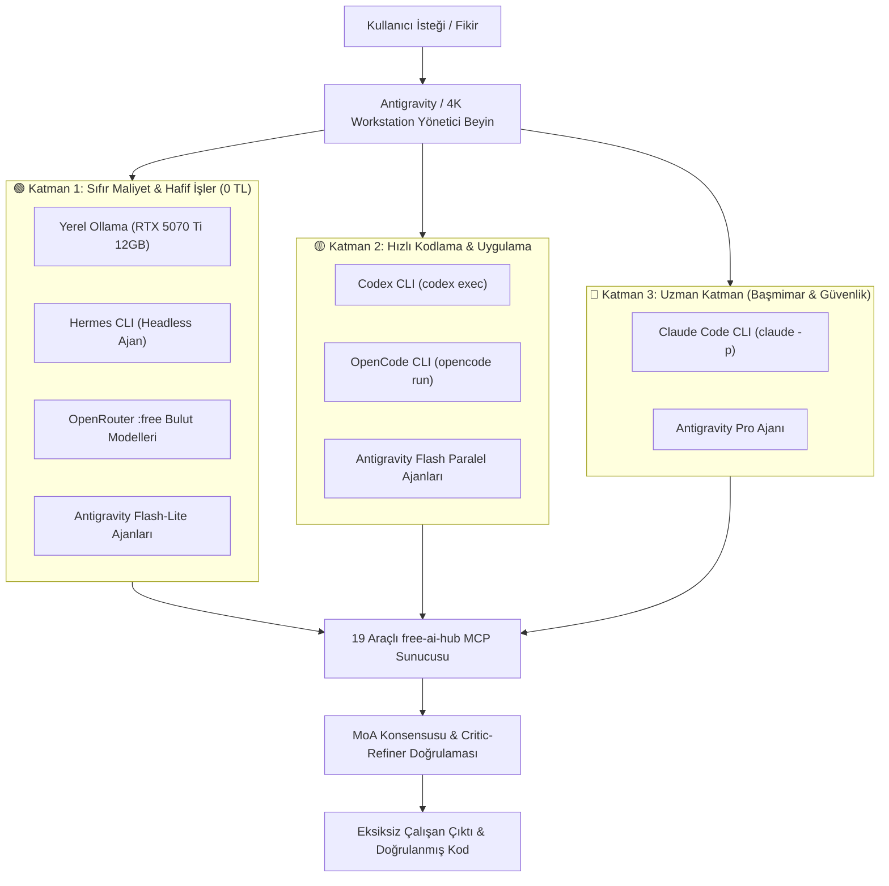

# 🚀 4K AI WORKSTATION: Living AI Engineering Workstation & 5-CLI Ecosystem

**4K AI WORKSTATION**, yerel yapay zeka motoru (**RTX 5070 Ti 12 GB VRAM üzerinde Ollama**), 5 büyük yapay zeka CLI kodlama ve ajan sistemi (**Antigravity**, **Claude Code**, **Codex CLI**, **OpenCode**, **Hermes**), 19 araçlı **`free-ai-hub` MCP Sunucusu** ve **$0.00 Sıfır API Harcaması Kalkanı** ile çalışan, kendi kendine yeten açık kaynak bir yapay zeka mühendislik ekosistemidir.

---

## 🔒 Kırmızı Çizgi: $0.00 API Harcaması Kalkanı (Zero API Spend Shield)

4K AI WORKSTATION mimarisinin tavizsiz temel ilkesidir:
- **SIFIR KULLANDIKÇA ÖDE / BAKİYELİ HARCAMA:** Sistem asla ve asla bakiye tüketen veya kredi kartı gerektiren ücretli API anahtarları üzerinden harcama yapmaz.
- **%100 ÜCRETSİZ KAYNAKLAR:** Tüm bulut çıkarımları yalnızca OpenRouter `:free` etiketli modeller ve yerel RTX 5070 Ti donanımında çalışan açık kaynaklı Ollama modelleri üzerinden yürütülür.
- **SABİT CLI ABONELİK KORUMASI:** Kullanıcının mevcut masaüstü abonelikleri (`Claude Code`, `Codex`, `Antigravity`), CLI oturumu modunda (ekstra 1 kuruş bile fatura edilmeden) çalıştırılır.

---

## 🏛️ 5-CLI Birleşik Orkestrasyon Mimarisi & 3 Katmanlı İşçi Havuzu

Sistem, gelen görevleri tek bir modele yükleyerek kota veya donanım darboğazı yaratmak yerine, 3 katmanlı akıllı işçi havuzuna modüler olarak paylaştırır:



### 🟢 Katman 1: Ücretsiz / 0 Kota (Hafif & Standart İşler)
* **Hedef Araçlar:** Yerel Ollama (`qwen2.5-coder:14b`, `llama3`), OpenRouter `:free` modelleri, `Hermes CLI`, Antigravity `flash_lite` alt ajanları.
* **Kullanım Alanları:** Canlı web araştırması, dokümantasyon, docstring yazımı, regex desenleri, JSON/YAML şablonları, rutin yardımcı betikler ve veri dönüştürme.

### 🟡 Katman 2: Çok Düşük Kota & Yüksek Hız (Orta Düzey Kodlama & Test)
* **Hedef Araçlar:** Paralel Antigravity `flash` alt ajanları (3-5 eşzamanlı işçi), `OpenCode CLI`, `Codex CLI` (ChatGPT masaüstü oturumu).
* **Kullanım Alanları:** Kullanıcı arayüzü (UI) bileşenleri, REST API uç noktaları, CRUD operasyonları, birim (unit) ve entegrasyon testleri, mock veri üretimi, modül refactoring.

### 🔴 Katman 3: Uzman Katman (Sadece Ağır Mimari & Kritik Hata Ayıklama)
* **Hedef Araçlar:** `Claude Code CLI` (`claude -p`), Antigravity `pro` alt ajanı.
* **Kullanım Alanları:** Çok katmanlı sistem mimarisi, veri tabanı şema tasarımı, güvenlik protokolleri, döngüye giren zorlu hataların çözümü, performans optimizasyonu.

---

## ⚡ 19 Araçlı `free-ai-hub` MCP Sunucusu (v2.0 Ultimate)

`wrappers/opencode_free_hub_mcp.py` dosyası, Model Context Protocol (MCP) standardında çalışan ve hem `OpenCode` hem `Claude Code` hem de harici ajanlara hizmet veren 19 özel araç sunar:

| Araç Adı | Açıklama |
|---|---|
| `moa_consensus_engine` | Farklı ücretsiz modelleri (Pollinations, OpenRouter :free, Yerel Llama 3) aynı probleme koşturup sentezleyerek ortak konsensus üretir. |
| `critic_refiner_loop` | Yazılan kodu otomatik eleştiren (Critic) ve güvenlik açıklarını/hatalarını gideren (Refiner) otonom kalite döngüsü. |
| `repo_ast_map` | Kod tabanını context token harcamadan Python AST (Abstract Syntax Tree) ile analiz edip sınıfları, fonksiyonları ve importları 0 TL ile haritalar. |
| `cross_cli_orchestrator` | 5 CLI aracı (`agy`, `claude`, `codex`, `opencode`, `hermes`) arasında görev devri ve çapraz tetikleme sağlar. |
| `hardware_model_curator` | Yerel GPU VRAM (RTX 5070 Ti 12GB) durumuna göre en verimli modelleri (7B-14B Sweet Spot) seçer ve önerir. |
| `smart_auto_router` | İstem türünü (kod, analiz, sohbet, araştırma) analiz ederek en uygun sıfır maliyetli araca dinamik yönlendirir. |
| `subscription_cli_bridge` | Sistemdeki CLI abonelik araçlarının kurulu ve hazır olup olmadığını denetler. |
| `free_web_search` | DuckDuckGo HTML / Instant Search üzerinden 0 TL canlı internet araması yapar. |
| `free_url_reader` | Web sayfalarını ve dokümantasyonları okuyup saf markdown metnine dönüştürür. |
| `offline_code_validator` | Yazılan Python kodunun sözdizimini (syntax) AST parse ile çevrimdışı denetler. |
| `multi_model_synthesizer` | Farklı alt ajanlardan gelen parça çıktıları tek bir akıcı Türkçe rapora sentezler. |
| `system_health_telemetry` | CPU, RAM, VRAM ve anlık çalışma parametrelerini takip eder. |
| *(Ek 7 Yardımcı Araç)* | Dosya yönetimi, JSON formatlama, oturum geçmişi ve telemetri destek araçları. |

---

## 🔭 Otonom Evrim Motoru & Teknoloji Gözcüsü (`core/tech_scout.py`)

Workstation, durağan bir sistem değildir; yapay zeka dünyasındaki gelişmeleri sürekli canlı takip eden **`ContinuousEvolutionEngine`** motorunu içerir:

```powershell
.\.venv\Scripts\python.exe -m core.tech_scout
```

Bu komut çalıştırıldığında 4 canlı radar eşzamanlı olarak devreye girer:
1. **🟢 OpenRouter Canlı :free Model Radarı:** API üzerinden yeni çıkan `0.00 TL` etiketli modelleri, bağlam uzunluklarını (1M token'a varan) ve yeteneklerini keşfeder.
2. **🧠 Hugging Face & Ollama Trend Model Radarı:** RTX 5070 Ti (12 GB VRAM) donanımı için en verimli **Sweet Spot (7B - 14B)** modelleri (`qwen2.5-coder:14b`, `deepseek-r1:14b`, `qwen2.5-coder:7b`, `llama3.1:8b`, `phi4:14b`) denetler; yerel kurulum durumlarını raporlar.
3. **🌐 GitHub Açık Kaynak AI & MCP Eklenti Radarı:** GitHub API üzerinden en güncel MCP sunucularını, CLI araçlarını ve MoA kütüphanelerini canlı tarar.
4. **🖥️ 5-CLI Sürüm & Sağlık Denetçisi:** Sistemdeki `Antigravity`, `Claude Code`, `Codex`, `OpenCode`, `Hermes` ve `Ollama` araçlarının sürümlerini ve çalışabilirlik durumlarını test eder.

Sonuçlar terminalde şık ve kutulu bir Türkçe dashboard olarak sunulurken, eşzamanlı olarak `data/tech_evolution_report.json` ve `data/model_catalog.json` kataloglarına otomatik işlenir.

---

## 🛡️ Sıfır Abonelik Kesintisiz Çalışma Sigortası & Auto-Healing

- **Kesintisiz Geri Çekilme:** Herhangi bir bulut sağlayıcısının kotası bittiğinde süreç durmaz; sistem otomatik olarak yerel RTX 5070 Ti (12GB) üzerinde koşan `qwen2.5-coder:14b` ve `llama3` modellerine geri çekilir (failover).
- **Auto-Healing Döngüsü (`core/auto_healing.py`):** Kod üretildikten sonra arka planda test edilir. Bir hata veya istisna oluşursa kullanıcıya sormadan logları inceler, hatanın kaynağını tespit eder, dosyayı günceller ve tekrar doğrular.

---

## 📂 Proje Dizin Mimarisi

```text
nexus_ai_studio/
├── configs/                         # Temiz, gizli anahtarsız orkestrasyon şablonları
│   ├── CLAUDE.md                    # Claude Code ($0.00 Shield & Katman 3 kural seti)
│   ├── CODEX_AGENTS.md              # Codex CLI (Katman 2 Hızlı Uygulama kuralları)
│   ├── GEMINI.md                    # Antigravity Yönetici Kural Seti & Protokolü
│   ├── HERMES_SOUL.md               # Hermes 0 TL Ajan Ruhu ve Kimliği
│   ├── HERMES_SKILL.md              # Hermes Workstation API Entegrasyon Skill'i
│   └── opencode.template.json       # OpenCode temiz yapılandırma şablonu
├── core/
│   ├── agentic_brain.py             # Canlı internet araması ve ReAct ajan aklı
│   ├── auto_healing.py              # Kendi kendini onaran otonom yazılım fabrikası
│   ├── benchmark.py                 # Gerçek LLM Token/sn testi ve Ollama model indirme
│   ├── cli_registry.py              # 5-CLI araçlarının otomatik tespiti ve kaydı
│   ├── dispatcher.py                # İstek dağıtıcı ve otomatik eskalasyon zinciri
│   ├── hardware.py                  # GPU VRAM ve RAM kapasitesi tespiti
│   ├── librarian.py                 # OpenRouter & HF canlı model kütüphanecisi
│   ├── parallel_executor.py         # Paralel yürütücü & Mixture-of-Agents sentezleyici
│   ├── planner.py                   # LLM destekli modüler görev parçalayıcı
│   ├── quota_manager.py             # Model kullanım ve kota takip yöneticisi
│   ├── router.py                    # Akıllı yönlendirici ve maliyet/yetenek matrisi
│   ├── session_memory.py            # Çok turlu sohbet geçmişi hafızası
│   └── tech_scout.py                # Otonom Evrim Motoru & 4 Canlı Teknoloji Radarı
├── data/
│   ├── model_catalog.json           # Puanlanmış ve güncel model kataloğu
│   ├── tech_evolution_report.json   # Canlı evrim ve ekosistem denetim raporu
│   └── quotas.json                  # Model kullanım kotaları
├── ui/
│   ├── server.py                    # FastAPI REST API arka uç sunucusu (:8000)
│   └── app.py                       # Streamlit etkileşimli kontrol paneli (:8501)
├── wrappers/
│   ├── base_wrapper.py              # Temel soyut CLI ve API sarmalayıcısı
│   ├── claude_code_wrapper.py       # Claude Code CLI (`claude -p`) sarmalayıcısı
│   ├── codex_wrapper.py             # OpenAI Codex CLI (`codex exec`) sarmalayıcısı
│   ├── hermes_wrapper.py            # Hermes CLI headless sarmalayıcısı
│   ├── ollama_wrapper.py            # Yerel Ollama REST sarmalayıcısı
│   ├── opencode_free_hub_mcp.py     # 19 Araçlı Ultimate MCP Sunucusu
│   ├── opencode_wrapper.py          # OpenCode CLI (`opencode run`) sarmalayıcısı
│   └── openai_compatible_wrapper.py # Genel OpenAI-uyumlu sağlayıcı sarmalayıcısı
├── tests/                           # 119 adet kapsamlı birim ve entegrasyon testi
├── 4k.bat                           # Workstation CLI hızlı başlatıcı
├── setup.ps1                        # Sanal ortam kurulum ve doğrulama betiği
└── run.ps1                          # Backend ve Dashboard başlatıcı
```

---

## 🔌 RESTful API Uç Noktaları

4K AI WORKSTATION arka ucu (`http://127.0.0.1:8000`) üzerinden tam programatik erişim sağlar:

| Yöntem | Uç Nokta | Açıklama |
|---|---|---|
| `POST` | `/query` | İstemleri akıllı yönlendirme, eskalasyon, paralel yürütme ve MoA senteziyle çözer. |
| `GET` | `/cli/tools` | Sistemdeki 5 CLI ajanının (`agy`, `claude`, `codex`, `opencode`, `hermes`) durumunu döner. |
| `GET` | `/hardware/info` | GPU VRAM, CPU çekirdekleri ve RAM miktarını raporlar. |
| `GET` | `/scout/report` | Teknoloji Gözcüsü ve otonom evrim raporunu döndürür. |
| `GET` | `/librarian/catalog` | Donanıma göre puanlanmış ve filtrelenmiş model kataloğunu listeler. |
| `POST` | `/workspace/build` | LLM çıktılarından çoklu dosya bloklarını ayrıştırıp projeyi diskte inşa eder. |
| `POST` | `/hardware/llm-benchmark` | Yerel Ollama modellerinde gerçek Token/sn ve TTFT hız testi yapar. |

---

## 🚀 Hızlı Başlangıç

### 1. Kurulum
```powershell
powershell -ExecutionPolicy Bypass -File .\setup.ps1
```

### 2. Otonom Evrim Motorunu Çalıştırma
```powershell
.\.venv\Scripts\python.exe -m core.tech_scout
```

### 3. Arka Uç ve Kontrol Panelini Başlatma
```powershell
powershell -ExecutionPolicy Bypass -File .\run.ps1
```
- **REST API Sunucusu:** `http://127.0.0.1:8000`
- **Streamlit Kontrol Paneli:** `http://localhost:8501`

### 4. Testleri Doğrulama
```powershell
.\.venv\Scripts\python.exe -m unittest discover -s tests -v
```
*(119 birim testi ağ bağlantısından bağımsız olarak hatasız geçmektedir).*

---

## 📜 Lisans & Açık Kaynak
Bu proje MIT lisansı altında açık kaynak olarak sunulmaktadır. $0.00 API Shield ilkesine sadık kalarak dilediğiniz gibi geliştirebilir, modüllerini kendi projelerinizde kullanabilirsiniz.
